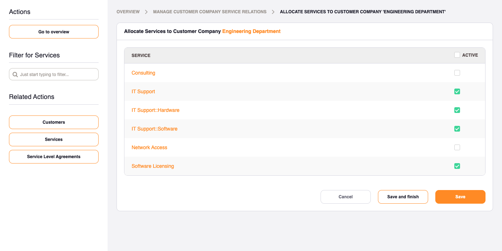

.. meta::
   :description: Build and assign a Znuny service catalog — create services, link them to customer users or default services, and control unknown customer visibility.
   :keywords: znuny services, service catalog, itil 4 service, service assignment, default services, customer services, ticket service

.. _PageNavigation admin_servicemanagement_services_index:

Managing Services
#################

ITIL 4 defines a service as: “A means of enabling value co-creation by facilitating outcomes that customers want to achieve, without the customer having to manage specific costs and risks.” You can create a service catalog for assignment to tickets and service level agreements (SLA).

Create a Service
****************

A service is added under Admin > Services.

Service assignment
******************

Under Admin > Customer Users <-> Services you may assign individual customers a service, or set a default service list.

Default Services

If you assign default services, these services will be available for all registered customers. If a customer user has any individual services, then the only these services will be available to them. Customer users with individual services cannot see default services. it is possible to allow default services to be assigned to unknown customers. This can be done in the system configuration. ``Ticket::Service::Default::UnknownCustomer``.

Services for Customer Companies
===============================

.. versionadded:: 7.5.1

    The former package Znuny-CustomerCompanyService is now part of Znuny.

Under *Admin* → *Customer Company ↔ Services* you can assign services to customer companies. Search for a customer company, then select the services it may use. Ticket dialogs offer the services of the customer company of the selected customer user.

The system configuration setting ``Ticket::Service::Behavior::CustomerCompany`` defines how these services are combined with the services of the customer user:

Always
    (Default) The services of the customer company are always added to the services of the customer user.
Fallback
    The services of the customer company are only used if no services are assigned to the customer user.

If the customer ID of a customer company changes, its service assignments are updated by the event module ``CustomerCompany::EventModulePost###2200-UpdateServiceMembership``.

.. note::

    SLA validation can delete an SLA when just the service is updated via a web service TicketUpdate operation, if the current SLA of the ticke does not contain the service updated by the web service.