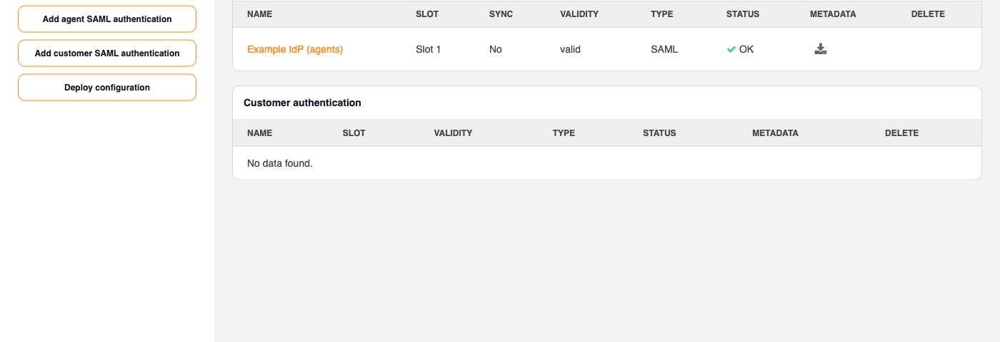
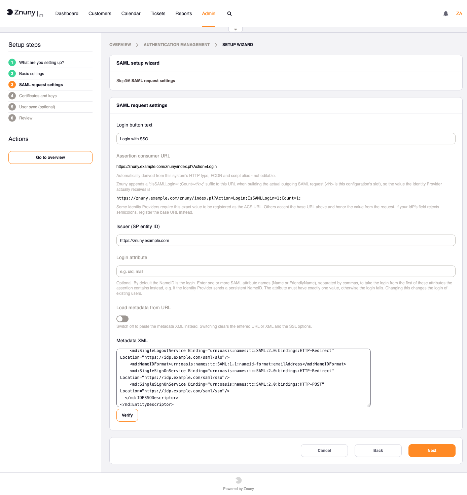
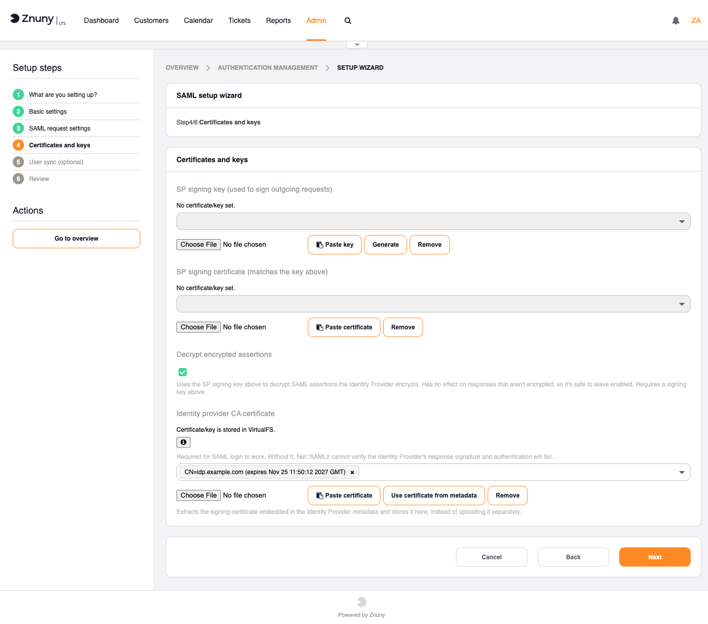

.. meta::
   :description: Configure Znuny single sign-on with SAML 2.0 — use HTTPBasicAuth with CAS, Kerberos, OpenID Connect or mod_auth_mellon, or native Kernel::System::Auth::SAML.
   :keywords: znuny saml, single sign-on, sso, kernel::system::auth::saml, mod_auth_mellon, kerberos sso, openid connect, idp authentication

.. _PageAdminSAMLConfigurationIndex:

Configure SAML backends for single sign-on (SSO)
################################################

Single Sign-on means a user can log in once and the credentials can be used by multiple applications. In Znuny, we offer SSO using:

Utilizing ``Kernel::System::Auth::HTTPBasicAuth`` as a backend, Znuny relies on the username exposed in the REMOTE_USER variable of the web server request. There are several authentication modules available like:

* CAS authentication (`mod_auth_cas <https://github.com/apereo/mod_auth_cas>`_)
* Kerberos (`mod_auth_gssapi <https://github.com/gssapi/mod_auth_gssapi>`_)
* OpenID Connect Relying (`mod_auth_openidc <https://github.com/OpenIDC/mod_auth_openidc>`_)
* SAML (`mod_auth_mellon <https://github.com/latchset/mod_auth_mellon>`_)

Utilizing ``Kernel::System::Auth::SAML`` as a backend, SAML 2.0 authentication can be used with an Identity Provider (IdP).

Here we discuss the settings available for SAML Authentication and Synchronization.

.. important::

    Since Znuny 7.5.1, SAML login requires Net::SAML2 0.89 or higher, and the assertion signatures are verified against the configured IdP certificate (``AuthModule::SAML::IdPCACert`` / ``Customer::AuthModule::SAML::IdPCACert``). Without this certificate the SAML login fails.

.. note::

    Two-factor authentication of Znuny is skipped for SAML logins. Enforce multi-factor authentication at the Identity Provider instead.

.. _PageAdminSAMLConfigurationAdminModule:

Authentication Management
*************************

.. versionadded:: 7.5.1

Instead of editing ``Kernel/Config.pm``, SAML 2.0 authentication for agents and customers can be configured in the admin interface under *Admin* → *Users, Groups & Roles* → *Authentication*. Only members of the group ``admin`` can use this module.

The overview lists all agent and customer authentication configurations with their slot, sync status, validity and status. From here you can:

* Start the *SAML wizard* for a guided setup.
* Add an agent or customer SAML authentication with the full edit screen.
* Download the SP metadata XML of a configuration to register Znuny at the Identity Provider.
* Deploy the configuration.

Slot
    Each configuration occupies one numbered slot, i.e. ``AuthModule<N>`` for agents or ``Customer::AuthModule<N>`` for customers. Only slots not used yet, e.g. in ``Kernel/Config.pm``, are offered.
Login button text
    The text of the SAML login button on the login screen.
Assertion consumer URL
    Derived automatically from ``HttpType``, ``FQDN`` and ``ScriptAlias``. Copy it to the Identity Provider.
Issuer (SP entity ID)
    The unique identifier of the Znuny instance.
Requested NameID format
    Unspecified (default), Persistent, Transient or Email address. Change this only if the Identity Provider requires a specific format.
Login attribute
    Optional. By default the NameID is the login. Enter one or more SAML attribute names (Name or FriendlyName), separated by commas, to take the login from the first of these attributes instead. The attribute must have exactly one value, otherwise the login fails.
Metadata
    Load the IdP metadata from a URL (with optional SSL options) or paste the metadata XML.
Certificates and keys
    The SP signing key and certificate (used to sign outgoing requests and published in the SP metadata), the signing algorithm (SHA-256 by default), the option to decrypt encrypted assertions, and the Identity provider CA certificate. Keys and certificates can be uploaded, pasted, generated as self-signed certificate, or, for the IdP certificate, taken from the metadata. They are stored in the virtual file system.
Attribute, group and role sync
    Agent configurations only. Enables ``Kernel::System::Auth::Sync::SAML`` for the same slot and maps SAML attributes to user attributes, initial groups, groups and roles (see :ref:`Synchronization <PageAdminSAMLConfigurationSync>`).

The *SAML wizard* guides you through the setup in six steps. The SAML request settings step shows the assertion consumer URL to register at the Identity Provider:

In the certificates step, the Identity Provider certificate can be taken from the metadata:

.. important::

    Saved configurations are not active until you click *Deploy configuration* on the overview. The deployment writes all valid configurations to ``Kernel/Config/Files/ZZZZnunyGeneratedAuthentication.pm``. If the deployment fails, fix the listed configurations or set them to invalid and deploy the rest.

If the Identity Provider supports Single Logout, Znuny also logs the user out at the Identity Provider.

Configuration Defaults
**********************

SAML authentication, if not done via an Apache module, can be directly configured in the ``Kernel/Config.pm``. Customers and Agents can be authenticated in this fashion. The following links to the GitHub repository will allow you to copy the necessary configurations to your ``Kernel/Config.pm`` for adaptation. You should be familiar with SAML and its configuration on both sides, IdP and SP.

.. tip::

    It is recommended to use a SAML tracer plugin for your browser when configuring SAML.

Agent Authentication
====================

`Agent Authentication (Defaults.pm)`_

.. _Agent Authentication (Defaults.pm): https://github.com/znuny/Znuny/blob/dev/Kernel/Config/Defaults.pm#L508

Customer Authentication
=======================

`Customer Authentication (Defaults.pm)`_

.. _Customer Authentication (Defaults.pm): https://github.com/znuny/Znuny/blob/dev/Kernel/Config/Defaults.pm#L1605

Agent Synchronization
=====================

`Agent Synchronization (Defaults.pm)`_

.. _Agent Synchronization (Defaults.pm): https://github.com/znuny/Znuny/blob/dev/Kernel/Config/Defaults.pm#L745

.. note::

    Configuration option, descriptions and example data should be read from the file directly.

Description of Options
**********************

Here is a list of SAML-related configuration options available in
``Kernel/Config/Defaults.pm`` for:

* AgentAuth (Agent Login)
* CustomerAuth (Customer Login)
* AuthSync (Agent Synchronization)

.. note::

    All examples use backend index ``1``. Multiple backends can be configured by incrementing the numeric suffix.

Agent Authentication (AuthModule)
=================================

Enable SAML Backend
~~~~~~~~~~~~~~~~~~~

.. code-block:: perl

    $Self->{'AuthModule1'} = 'Kernel::System::Auth::SAML';

.. note::

    Enables SAML 2.0 authentication for agents.

Identity Provider (IdP) Metadata
~~~~~~~~~~~~~~~~~~~~~~~~~~~~~~~~

Metadata URL
^^^^^^^^^^^^

.. code-block:: perl

   $Self->{'AuthModule::SAML::RequestMetaDataURL1'} = 'https://idp.example/metadata';

.. note::

    URL to retrieve the IdP metadata XML.

Metadata XML (Alternative to URL)
^^^^^^^^^^^^^^^^^^^^^^^^^^^^^^^^^

.. code-block:: perl

    $Self->{'AuthModule::SAML::RequestMetaDataXML1'} = '<xml>...</xml>';

.. note::

    Embed IdP metadata XML directly as a string.

SSL Options (only if Metadata URL is used)
^^^^^^^^^^^^^^^^^^^^^^^^^^^^^^^^^^^^^^^^^^

.. code-block:: perl

   $Self->{'AuthModule::SAML::RequestMetaDataURLSSLOptions1'} = {
       SSL_ca_file     => '/etc/ssl/certs/ca.pem',
       SSL_ca_path     => '/etc/ssl/certs',
       verify_hostname => 1,
   };

.. note::

    Optional SSL/TLS settings for metadata retrieval.

Request Signing (Optional)
^^^^^^^^^^^^^^^^^^^^^^^^^^

.. code-block:: perl

   $Self->{'AuthModule::SAML::RequestSignKey1'} = '/path/to/private.key';

.. note::

    Private key used to sign the SAML authentication request.

Login Button Text
~~~~~~~~~~~~~~~~~

.. code-block:: perl

   $Self->{'AuthModule::SAML::RequestLoginButtonText1'} = 'Login via SAML';

.. note::

    Custom text for the SAML login button. Translatable via :ref:`Translating Terminology <PageAdminTranslationIndex>`.

Service Provider (SP) Configuration
~~~~~~~~~~~~~~~~~~~~~~~~~~~~~~~~~~~

Assertion Consumer Service (ACS) URL
^^^^^^^^^^^^^^^^^^^^^^^^^^^^^^^^^^^^

.. code-block:: perl

   $Self->{'AuthModule::SAML::RequestAssertionConsumerURL1'}
       = 'https://yourhost/znuny/index.pl?Action=Login';

.. note::

    Login callback endpoint for the IdP to send the SAML response. This URL should be created from your system settings:
    ``$Self->{'AuthModule::SAML::RequestAssertionConsumerURL1'} = ( $Self->{HttpType} // '' ) . '://' . $Self->{FQDN} . '/' . $Self->{ScriptAlias} . 'index.pl?Action=Login';``

Issuer
^^^^^^

.. code-block:: perl

   $Self->{'AuthModule::SAML::Issuer1'} = 'https://your-znuny-instance/znuny/';

.. note::

    Unique identifier for your Znuny instance, included in SAML requests. Often the URL of your Znuny instance.

Identity Provider Trust
~~~~~~~~~~~~~~~~~~~~~~~

IdP CA Certificate
^^^^^^^^^^^^^^^^^^

.. code-block:: perl

   $Self->{'AuthModule::SAML::IdPCACert1'} = '/path/to/idp-ca.pem';

.. note::

    Signing certificate of the Identity Provider. It is used to verify the signatures of the SAML response and assertion. Required since Znuny 7.5.1.

Login Attribute (Optional)
~~~~~~~~~~~~~~~~~~~~~~~~~~

.. code-block:: perl

   $Self->{'AuthModule::SAML::UserLoginAttribute1'} = [ 'uid', 'mail' ];

.. note::

    Takes the login from an attribute of the signed assertion instead of the NameID, e.g. if the Identity Provider sends a persistent NameID. The first of the given attributes (Name or FriendlyName) contained in the assertion is used. It must have exactly one value, otherwise the login fails. There is no fallback to the NameID.

    .. versionadded:: 7.5.1

Further Optional Settings
~~~~~~~~~~~~~~~~~~~~~~~~~

.. code-block:: perl

   # NameIDPolicy format sent in the request and published in the SP metadata
   $Self->{'AuthModule::SAML::RequestNameIDFormat1'} = 'urn:oasis:names:tc:SAML:1.1:nameid-format:unspecified';

   # Hash algorithm for signing the request: sha256, sha384, sha512 or sha1
   $Self->{'AuthModule::SAML::RequestSignSigAlg1'} = 'sha256';

   # Private key to decrypt encrypted assertions
   $Self->{'AuthModule::SAML::ResponseEncryptKey1'} = '/path/to/private.key';

.. note::

    The same settings are available for customers with the prefix ``Customer::AuthModule::SAML::``.

Customer Authentication (Customer::AuthModule)
==============================================

Enable SAML Backend
~~~~~~~~~~~~~~~~~~~

.. code-block:: perl

   $Self->{'Customer::AuthModule1'} = 'Kernel::System::CustomerAuth::SAML';

.. note::

    Enables SAML 2.0 authentication for customer users.

Identity Provider Metadata
~~~~~~~~~~~~~~~~~~~~~~~~~~

.. code-block:: perl

   $Self->{'Customer::AuthModule::SAML::RequestMetaDataURL1'} = 'https://idp.example/metadata';

Or:

.. code-block:: perl

   $Self->{'Customer::AuthModule::SAML::RequestMetaDataXML1'} = '<xml>...</xml>';

.. note::

    Metadata Provisioning for Customer SAML Authentication.

SSL Options (Only if Metadata URL is used)
^^^^^^^^^^^^^^^^^^^^^^^^^^^^^^^^^^^^^^^^^^

.. code-block:: perl

   $Self->{'Customer::AuthModule::SAML::RequestMetaDataURLSSLOptions1'} = {
       SSL_ca_file     => '/etc/ssl/certs/ca.pem',
       SSL_ca_path     => '/etc/ssl/certs',
       verify_hostname => 1,
   };

.. note::

    Optional SSL/TLS settings for metadata retrieval.

Request Signing
~~~~~~~~~~~~~~~

.. code-block:: perl

   $Self->{'Customer::AuthModule::SAML::RequestSignKey1'} = '/path/to/private.key';

.. note::

    Private key used to sign the SAML authentication request.

Login Button Text
~~~~~~~~~~~~~~~~~

.. code-block:: perl

   $Self->{'Customer::AuthModule::SAML::RequestLoginButtonText1'} = 'Customer Login via SAML';

.. note::

    Custom text for the SAML login button on the customer login page. Translatable via :ref:`Translating Terminology <PageAdminTranslationIndex>`.

Service Provider Configuration
~~~~~~~~~~~~~~~~~~~~~~~~~~~~~~

Assertion Consumer URL
^^^^^^^^^^^^^^^^^^^^^^

.. code-block:: perl

   $Self->{'Customer::AuthModule::SAML::RequestAssertionConsumerURL1'}
       = 'https://yourhost/otrs/customer.pl?Action=Login';

.. note::

    Customer login callback endpoint. This URL should be created from your system settings:
    ``$Self->{'AuthModule::SAML::RequestAssertionConsumerURL1'} = ( $Self->{HttpType} // '' ) . '://' . $Self->{FQDN} . '/' . $Self->{ScriptAlias} . 'customer.pl?Action=Login';``

Issuer
^^^^^^

.. code-block:: perl

   $Self->{'Customer::AuthModule::SAML::Issuer1'} = 'https://your-znuny-instance/znuny/';

.. note::

    Unique identifier for your Znuny instance, included in SAML requests. Often the URL of your Znuny instance.

Identity Provider Trust
^^^^^^^^^^^^^^^^^^^^^^^

.. code-block:: perl

   $Self->{'Customer::AuthModule::SAML::IdPCACert1'} = '/path/to/idp-ca.pem';

.. note::

    Signing certificate of the Identity Provider for customer authentication. Required since Znuny 7.5.1.

.. code-block:: perl

   $Self->{'Customer::AuthModule::SAML::UserLoginAttribute1'} = [ 'uid', 'mail' ];

.. note::

    Optional. Takes the customer login from an assertion attribute instead of the NameID, see the agent setting above.

.. _PageAdminSAMLConfigurationSync:

Synchronization (AuthSyncModule)
================================

Enable SAML Sync Backend
~~~~~~~~~~~~~~~~~~~~~~~~

.. code-block:: perl

   $Self->{'AuthSyncModule1'} = 'Kernel::System::Auth::Sync::SAML';

.. note::

    Synchronizes user data after successful SAML authentication.

.. note::

    This module can be used in conjunction with Agent SAML authentication backends to sync user attributes, group memberships, and roles based on the SAML response.

User Attribute Mapping
~~~~~~~~~~~~~~~~~~~~~~

.. code-block:: perl

   $Self->{'AuthSyncModule::SAML::UserSyncMap1'} = {
       UserFirstname => 'givenName',
       UserLastname  => 'sn',
       UserEmail     => 'mail',
   };

The keys are the user (agent) attributes and the values are the variables of the SAML response. First name, last name, and email are mandatory. Additional attributes can be configured too.

.. note::

    Maps SAML response attributes to Znuny user fields.

Initial Group Assignment
~~~~~~~~~~~~~~~~~~~~~~~~

.. code-block:: perl

   $Self->{'AuthSyncModule::SAML::UserSyncInitialGroups1'} = [
       'users',
   ];

.. note::

    Groups assigned to **newly** created users.

Group Mapping via SAML Attribute
~~~~~~~~~~~~~~~~~~~~~~~~~~~~~~~~

**Define Attribute Name**

.. code-block:: perl

   $Self->{'AuthSyncModule::SAML::UserSyncGroupsDefinition::Attribute1'} = 'MemberOf';

**Define Mapping**

.. code-block:: perl

   $Self->{'AuthSyncModule::SAML::UserSyncGroupsDefinition1'} = {
       Support => {
           users => { rw => 1 },
       },
   };

.. note::

    Maps SAML attribute values to Znuny groups with permissions.

Attribute-Based Group Mapping (Alternative Structure)
~~~~~~~~~~~~~~~~~~~~~~~~~~~~~~~~~~~~~~~~~~~~~~~~~~~~~

.. code-block:: perl

   $Self->{'AuthSyncModule::SAML::UserSyncAttributeGroupsDefinition1'} = {
       MemberOf => {
           Admins => {
               admin => { rw => 1 },
           },
       },
   };

.. note::

    Maps SAML attribute values to Znuny groups with permissions.

Role Mapping via SAML Attribute
~~~~~~~~~~~~~~~~~~~~~~~~~~~~~~~

**Define Attribute Name**

.. code-block:: perl

   $Self->{'AuthSyncModule::SAML::UserSyncRolesDefinition::Attribute1'} = 'Role';

.. note::

    Name of the SAML attribute containing role information.

**Define Mapping**

.. code-block:: perl

   $Self->{'AuthSyncModule::SAML::UserSyncRolesDefinition1'} = {
       Operations => {
           ZnunyRole1 => 1,
           ZnunyRole2 => 0,
       },
   };

.. note::

    Maps SAML attribute values to Znuny roles.

Attribute-Based Role Mapping (Alternative Structure)
~~~~~~~~~~~~~~~~~~~~~~~~~~~~~~~~~~~~~~~~~~~~~~~~~~~~

.. code-block:: perl

   $Self->{'AuthSyncModule::SAML::UserSyncAttributeRolesDefinition1'} = {
       Role => {
           Admin => {
               AdminRole => 1,
           },
       },
   };

.. note::

    Maps SAML attribute values to Znuny roles with permissions.

Examples
========

.. toctree::
   :maxdepth: 2

   examples/index
