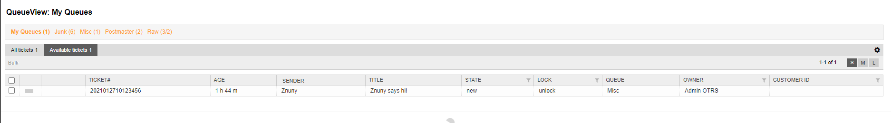
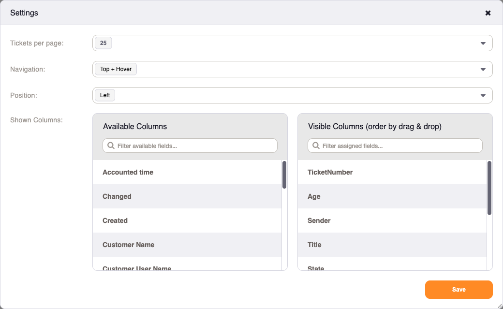
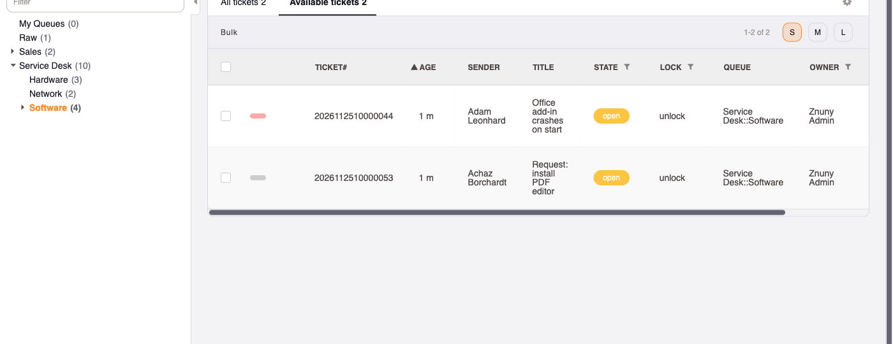

.. meta::
   :description: Work Znuny tickets grouped by queue — drill down the queue hierarchy, focus on My Queues from personal settings and pick the next ticket to process.
   :keywords: znuny queue view, view by queue, my queues, queue hierarchy, ticket queue, queue overview

View by Queue
#############
.. _PageNavigation agentinterface_overviews_agentticketqueueview:

Access this view by clicking on the :fa:`folder` in the navigation toolbar or navigating to *Queue view* under the *Ticket* menu.

By default, this list aggregates all queues selected as *My Queues* under the *Personal Settings* menu.

You may further filter tickets by drilling down the queue structure.

.. note::

    All tickets of the sub-queues are listed when double-clicking the queue name.

Additional filters are

All tickets
    List all tickets even if locked
Available tickets
    (Default) List tickets that are not locked

Navigation Layout
*****************
.. _PageNavigation agentinterface_overviews_agentticketqueueview_navlayout:

.. versionadded:: 7.5.1

The queue navigation above the ticket list can be shown in different layouts. The system default is defined by ``Ticket::Frontend::AgentTicketQueue###NavLayout``:

Top
    (Default) Shows one queue level at a time, without hover menus.

    .. image:: images/queue_view_nav_top.png
        :alt: Image queue_view_nav_top

Top + Hover
    Shows the hierarchical navigation bar. Sub-queues open as hover submenus.

    .. image:: images/queue_view_nav_tophover.png
        :alt: Image queue_view_nav_tophover

Each agent can override the system default in the settings dialog of the ticket list (cog wheel icon). In addition to *Top* and *Top + Hover*, agents can select *Sidebar*: the queue tree is shown as a filterable sidebar next to the ticket list. The *Position* option places the sidebar on the left or right side. The sidebar remembers expanded and collapsed queues.

