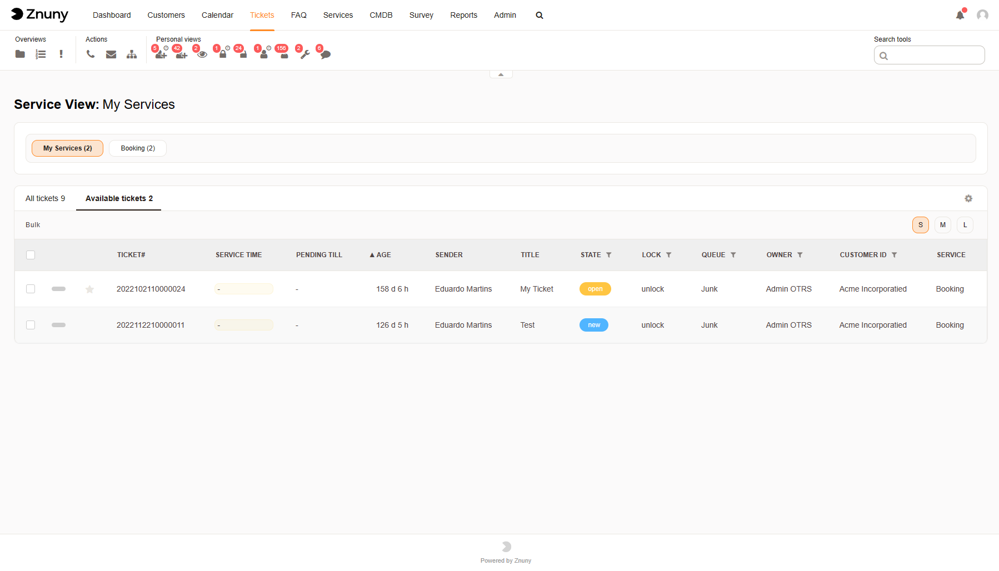

.. meta::
   :description: Review Znuny tickets grouped by service — focus on services selected in personal preferences so you only see requests that match your area of responsibility.
   :keywords: znuny service view, view by service, my services, ticket service, service overview, service filter

View by Service
###############
.. _PageNavigation agentinterface_overviews_agentticketserviceview:

Select *Service View* from the *Ticket* navigation menu, use the :fa:`wrench` toolbar icon if configured.

.. important::

    The icon will only appear if you've selected services under *My Services* in the user preferences screen.

.. note::

    All ticket are grouped by service. A user must have rw permissions in the tickets queue to see a ticket.

Filter all tickets in the system:

All
    List of open tickets, even if locked.
Available
    List of open tickets, not currently locked.

Navigation Layout
*****************
.. _PageNavigation agentinterface_overviews_agentticketserviceview_navlayout:

.. versionadded:: 7.5.1

The service navigation above the ticket list can be shown in different layouts. The system default is defined by ``Ticket::Frontend::AgentTicketService###NavLayout``:

Top
    (Default) Shows one service level at a time, without hover menus.
Top + Hover
    Shows the hierarchical navigation bar. Sub-services open as hover submenus.

Each agent can override the system default in the settings dialog of the ticket list (cog wheel icon). In addition to *Top* and *Top + Hover*, agents can select *Sidebar*: the service tree is shown as a filterable sidebar next to the ticket list. The *Position* option places the sidebar on the left or right side. The sidebar remembers expanded and collapsed services.
