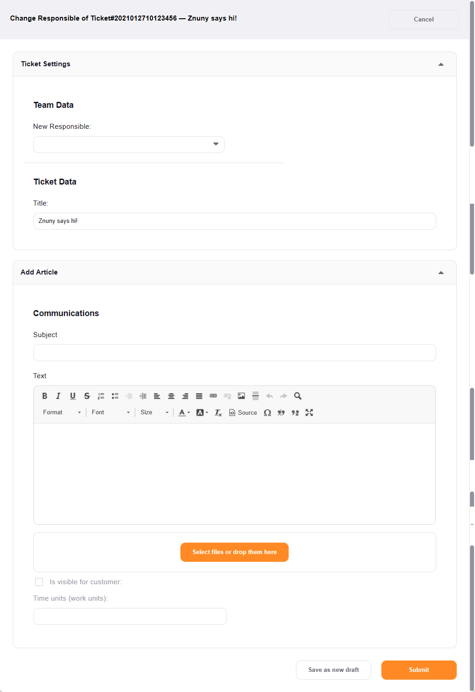

.. meta::
   :description: Take responsibility for a Znuny ticket — once activated, the responsible agent gains full ticket permissions across queues, acting as a second ticket owner.
   :keywords: znuny responsible agent, ticket responsible, second owner, take responsibility, responsible permission, responsible feature

.. _PageNavigation ticketviews_agentticketresponsible:

Become the Responsible Agent
############################

The responsible feature must be activated, and then you can use the :ref:`ticket menu <PageNavigation ticketviews_agentticketzoom_ticketmenu>` choosing People -> Responsible to take responsibility for the ticket. The responsible agent has full-permissions on the ticket in any queue, just as the owner does.

It is a second ticket owner.

.. important::

    You must have full-permissions (rw) in a queue to be assigned as the responsible of the ticket.

Reset the Responsible on Queue Change
*************************************

.. versionadded:: 7.5.1

If the ticket event module ``Ticket::EventModulePost###2750-ForceResponsibleResetOnMove`` is enabled, the responsible of a ticket is reset when the ticket is moved to another queue. Afterwards, the ticket has no personal responsible agent anymore (the responsible is set to the system user, as for new tickets). No notification is sent. The setting is disabled by default.
