.. meta::
   :description: Open the Znuny ticket zoom to review articles, properties and link data — launch every agent action from the ticket and article menus in a single screen.
   :keywords: znuny ticket zoom, ticket detail view, article menu, ticket menu, ticket overview, ticket zoom screen

View Ticket Details
###################
.. _PageNavigation ticketviews_agentticketzoom_index:

Here's an example of a ticket detail view (AgentTicketZoom).

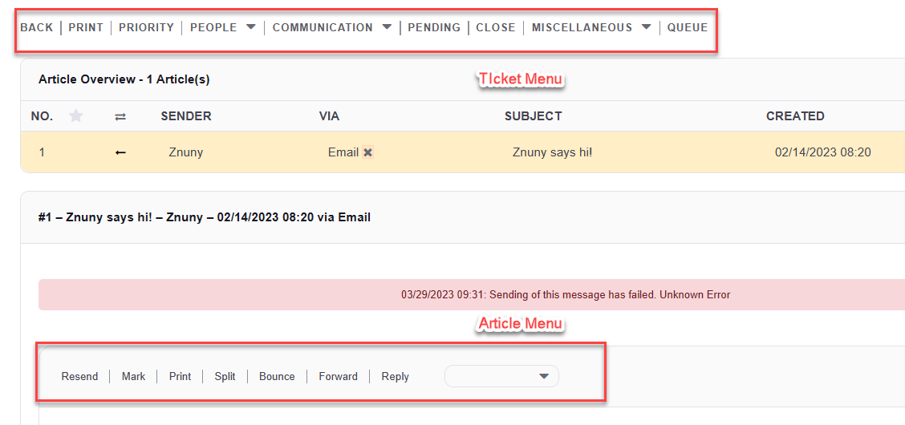

When you click on a ticket number from an overview screen or a link in an email notification, you'll land here.

Menus
*****

At this screen, you have access to all other screens. Here you can manipulate ticket data or review and add communications. The menus are separated for the ticket and each communication.

Ticket Menu
===========
.. _PageNavigation ticketviews_agentticketzoom_ticketmenu:

The ticket menu gives you access to the ticket data. Ticket data is modifiable information about the ticket like, but not limited to:

* Queue
* State
* Type
* Priority
* Owner
* Customer
* Customer User
* User-Defined Data (Dynamic Fields)

.. note::
    
    Your menu can and may differ based on permissions and configuration.

Clustered Items
~~~~~~~~~~~~~~~

The ticket menu items are in clusters by default, and the clusters are configurable in the system configuration. Per default, the following clusters are configured:

* People

  * :ref:`Owner <PageNavigation ticketviews_agentticketowner>` - Set the ticket owner. 
  * :ref:`Customer <PageNavigation ticketviews_agentticketcustomer>` - Assign a customer. 

* Communication

  * :ref:`Note <PageNavigation ticketviews_agentticketnote>` - Add a note.
  * :ref:`Phone Call Outbound <PageNavigation ticketviews_agentticketphoneoutbound>` - Make a call.
  * :ref:`Phone Call Inbound <PageNavigation ticketviews_agentticketphoneinbound>` - Take a call.

* Miscellaneous

  * :ref:`Lock <PageNavigation ticketviews_agentticketlock>` - Lock the ticket and take ownership.
  * :ref:`History <PageNavigation ticketviews_agenttickethistory>`
  * :ref:`Free Fields <PageNavigation ticketviews_agentticketfreetext>`
  * :ref:`Link <PageNavigation ticketviews_agentticketlink>`
  * :ref:`Merge <PageNavigation ticketviews_agentticketmerge>`
  * :ref:`New Appointment <PageNavigation agentinterface_appointments_index>`

Un-Clustered Items
~~~~~~~~~~~~~~~~~~~
* Back - Go back to the last overview.
* Attachments - Select and download attachments of all articles of the ticket at once (``Ticket::Frontend::MenuModule###999-AgentTicketAttachmentList``).

.. versionadded:: 7.5.1

    The *Attachments* menu item is part of the integrated former package Znuny-AdvancedAttachments.

    .. image:: images/attachments_list.png
        :alt: Image attachments_list

* Print - Print all articles.

.. note::

    Images and HTML formatting is not printed. Just plain text.

* :ref:`Priority <PageNavigation ticketviews_agentticketpriority>` - Change the priority.
* :ref:`Pending <PageNavigation ticketviews_agentticketreminder>` - Set the ticket to pending.
* :ref:`Close <PageNavigation ticketviews_agentticketactionclose>` - Close the ticket.

Optional items
~~~~~~~~~~~~~~~

There may be many optional menu items based on your installed packages.

- Enroll ticket in a process.

.. note::

    Only available when at least one process is active whose start activities initial dialog is accessible by the agent.

Article Menu
============
.. _PageNavigation ticketviews_agentticketzoom_articlemenu:

Each article has a different set of menu options, based on it's type. All possible menu options are seen below. Articles are selected from the article tree found between the ticket menu article menu.

Common options
~~~~~~~~~~~~~~

* Mark - Mark a communication important.

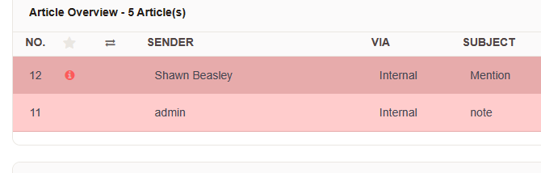

* Print - Print the selected article.
* Split - Create a new ticket based upon the currently selected article. You can create a new phone, email, or process ticket directly from any article.

.. note::

    You should generally spilt a ticket from a customer article. Otherwise the agent is pre-filled as the customer of the new ticket.

    Additionally, the original article remains in the old ticket.

    The newly created ticket is automatically linked to the original ticket as a child.

Communication Options
~~~~~~~~~~~~~~~~~~~~~~

To respond to tickets, you can use one of other options.

* Reply to Note - Reply to a note.
* Forward - Forward the message.
* Bounce - Redirect the mail to another address.
* Reply - Reply to sender.
* Reply all - Reply to sender and all Cc: recipients.
* Message Log - Jump to the communication log.

.. note::

    The Message Log is only available to administrators or their delegates.

* Resend - Resend a failed communication.

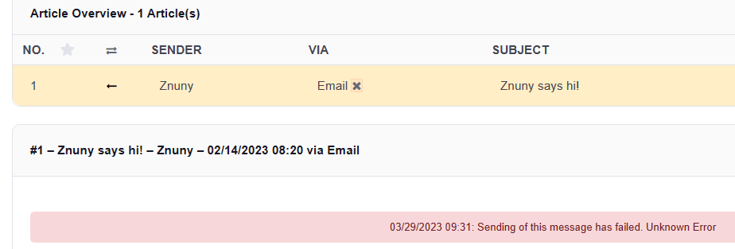

    The Resend option is only available for failed communications. If the communication was successful, this option will not be available.

.. _zoom_communication_table:

Communications Table
********************

In each ticket, there is a table showing all articles in the ticket. Articles can be shown individually, or they may all be viewed at once using the cog wheel to change back and forth. Once set, the setting is persistent and applies to all tickets.

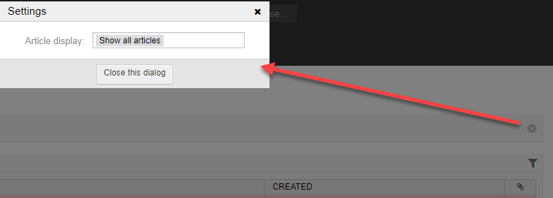

.. note:: 

    Viewing all articles will mark all articles and the ticket as read, which may not be desirable.

If ``Ticket::Frontend::TicketArticleFilter`` activated, you may also use the article filter to show only specific article types from specific senders. This may also be made persistent.

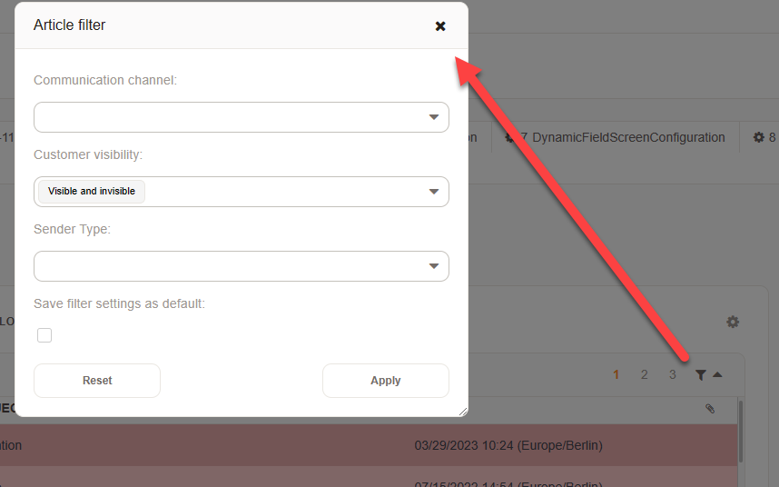

.. versionadded:: 7.5.1

    The article filter dialog also has a *Content* field to filter articles by their text. Wildcards are supported, e.g. ``Te*t``. The search uses the article search index.

    Article dynamic fields can be added to the filter dialog with ``Ticket::Frontend::TicketArticleFilterDynamicField``. Only dynamic fields of the object type *Article* with the field types Text, TextArea, Dropdown, Multiselect and Checkbox are supported.

    .. image:: images/article_filter_content.png
        :alt: Image article_filter_content

Attachments
===========
.. _PageNavigation ticketviews_agentticketzoom_attachments:

.. versionadded:: 7.5.1

    The former packages Znuny-AdvancedAttachments and Znuny-ZoomArticlePDFPreview are now part of Znuny.

Attachments of an article can be opened in a preview overlay (images, PDFs and other permitted types). The preview is controlled by ``Attachment###EnablePreview`` and the article attachment module ``Ticket::Frontend::ArticleAttachmentModule###0-Preview``.

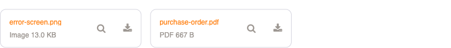

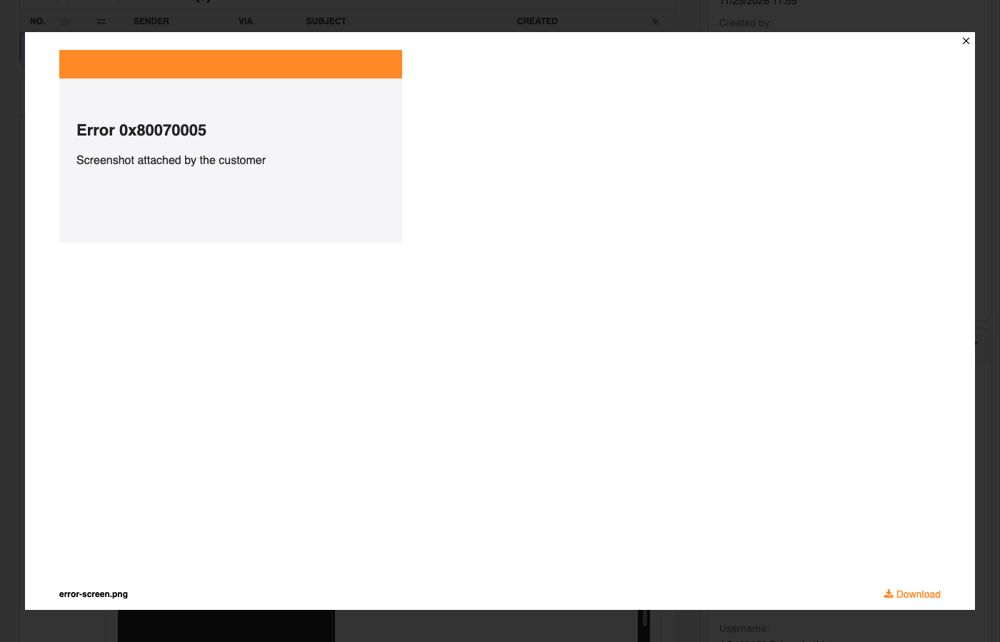

PDF attachments can also be shown embedded below the article. The size of this preview is defined by ``ArticleZoomPDFPreview###Width`` (default ``100%``) and ``ArticleZoomPDFPreview###Height`` (default ``500px``). Agents can change both values in their personal preferences. ``ArticleZoomPDFPreview###TicketAttributes###ActivatePreview`` restricts the embedded preview to tickets with the given attributes, ``ArticleZoomPDFPreview###TicketAttributes###ShowFirstPreview`` defines for which tickets the preview of the first PDF is opened automatically.

In ticket action dialogs such as note, reply, forward or close, agents can add attachments of other articles of the ticket without downloading and uploading them again. See :ref:`Reuse Attachments of Other Articles <PageNavigation ticketviews_agentticketactioncommon_reuseattachments>`.

Related system configuration settings:

``Attachment###ShowAttachmentsCount``
    Number of attachments shown by default (default ``10``).
``Attachment###AgentTicketZoom###ShowAttachmentsCount``
    Number of attachments shown in the ticket zoom (default ``5``).
``Attachment###DeactivateWidgetArticleCount`` / ``Attachment###DeactivateWidgetAttachmentCount``
    Disable the attachment widgets when the ticket reaches the given number of articles or attachments (``0`` means no limit).

Information Widgets
*******************

On the right-hand side of each ticket, there is a set of widgets which provide different information.

Ticket Data
===========

Displays current ticket data including dynamic fields.

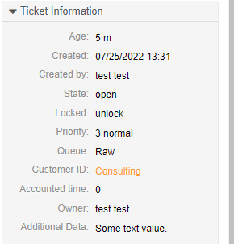

Customer User
=============

Shows information about the customer user and customer.

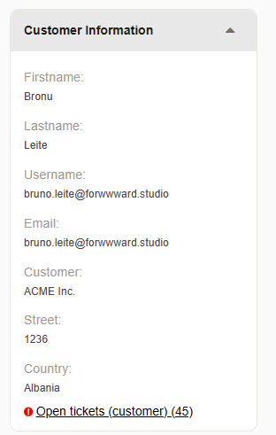

Link Object
===========

If the ``ViewMode`` is not set to *Complex*, a list of linked ticket will appear in the widget on the right side.

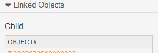

If the ``ViewMode`` is set to *Complex*, linked tickets are shown in a table below the articles. 

.. versionadded:: 7.5.1

    The columns of the linked tickets table have multiselect column filters. They can be disabled with ``LinkObject::ComplexTable::ColumnFilters###Ticket``. The filters are not shown in the *Link* popup.

    .. image:: images/linked_tickets_filter.png
        :alt: Image linked_tickets_filter

Attachments Widget
==================

.. versionadded:: 7.5.1

The widget ``Ticket::Frontend::AgentTicketZoom###Widgets###0900-Attachments`` lists all attachments of the ticket for download. See :ref:`Attachments <PageNavigation ticketviews_agentticketzoom_attachments>`.

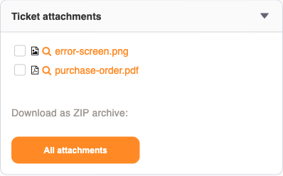

.. _PageNavigation ticketviews_agentticketzoom_mentions:

Mentions
========

A list of users which are mentioned in this ticket are visible. Users on the mention list can be removed by the owner or responsible of the ticket.

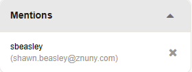

.. versionadded:: 7.3.1

    It's now possible to copy the ticket number, and the ticket title to the clipboard by clicking on the ticket number in the header.

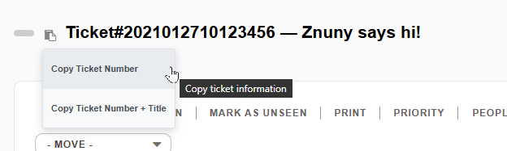

    Copy Ticket Number and Title to Clipboard

   
